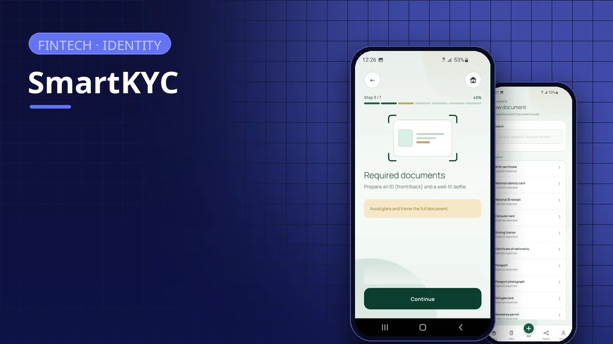
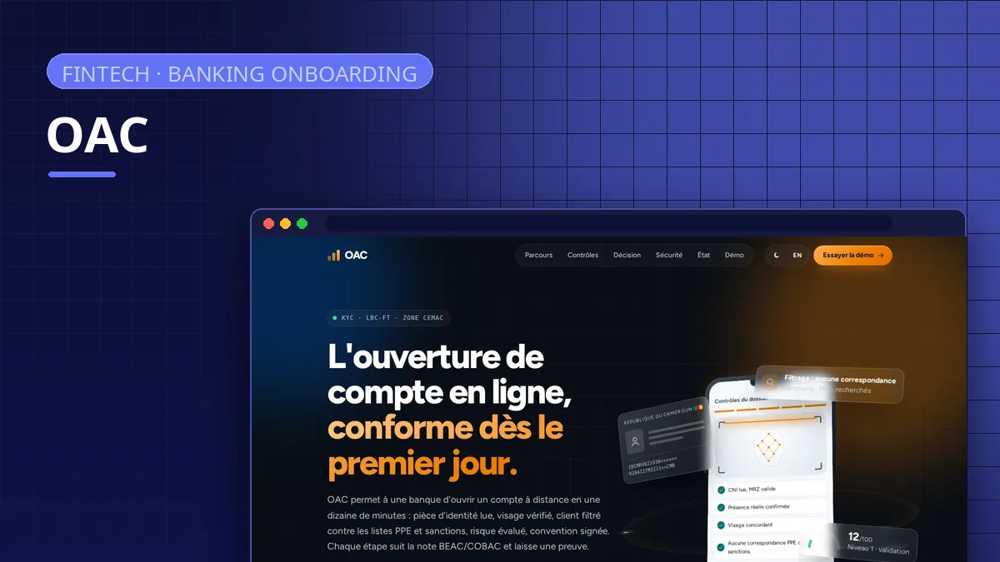
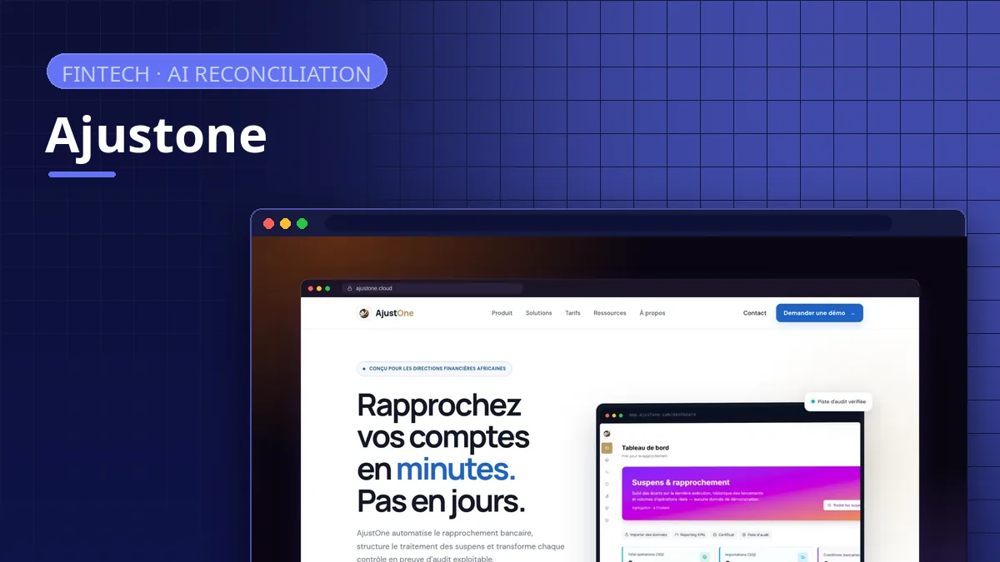
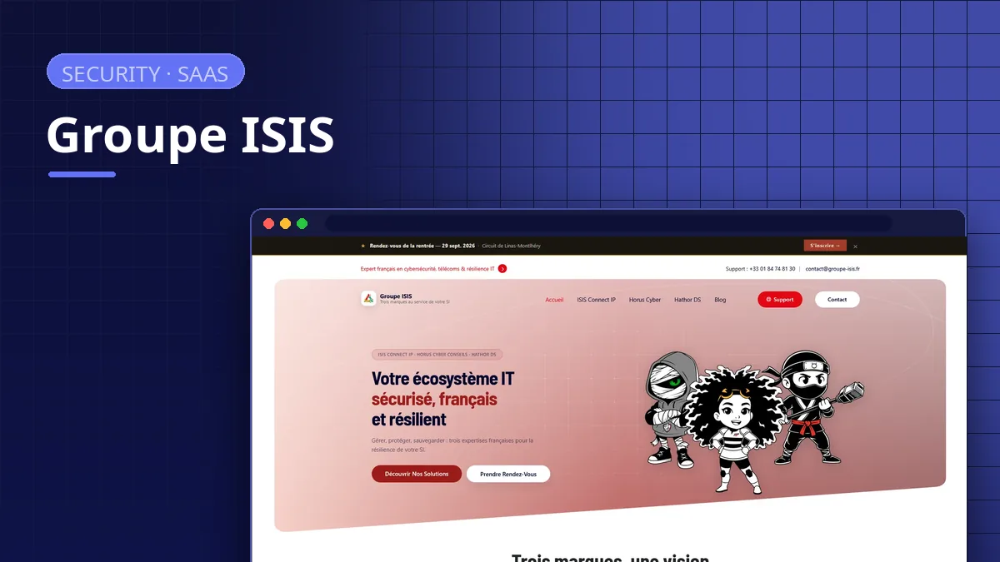
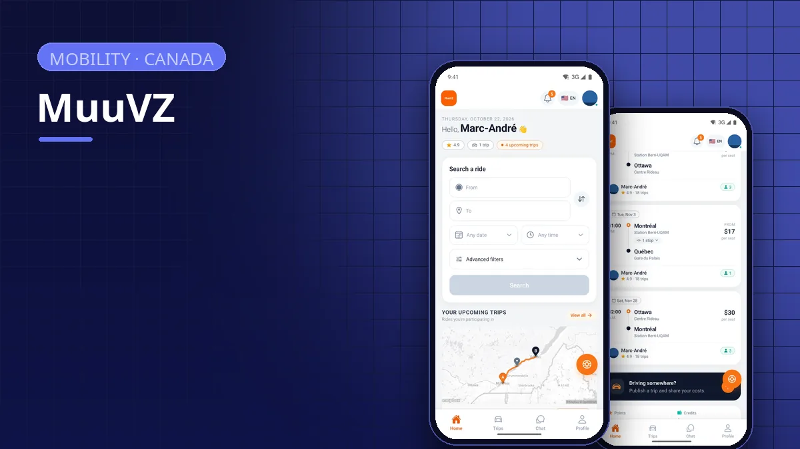
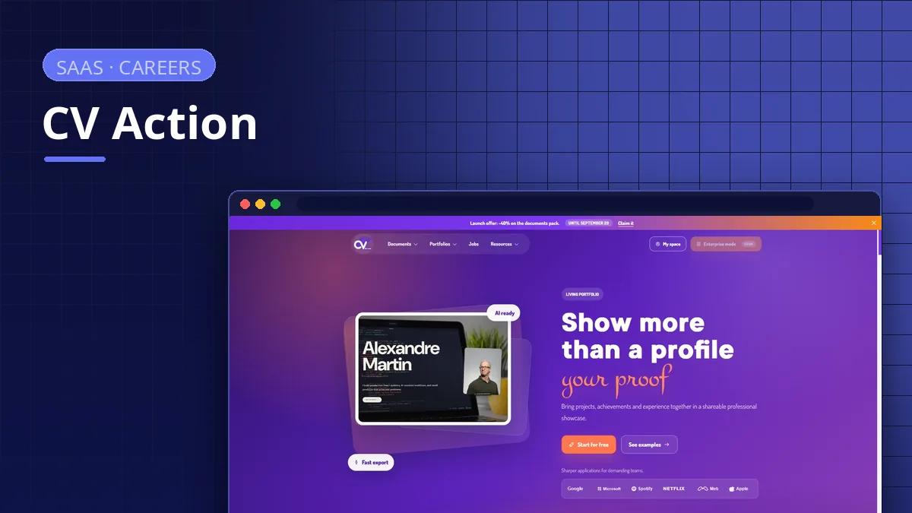
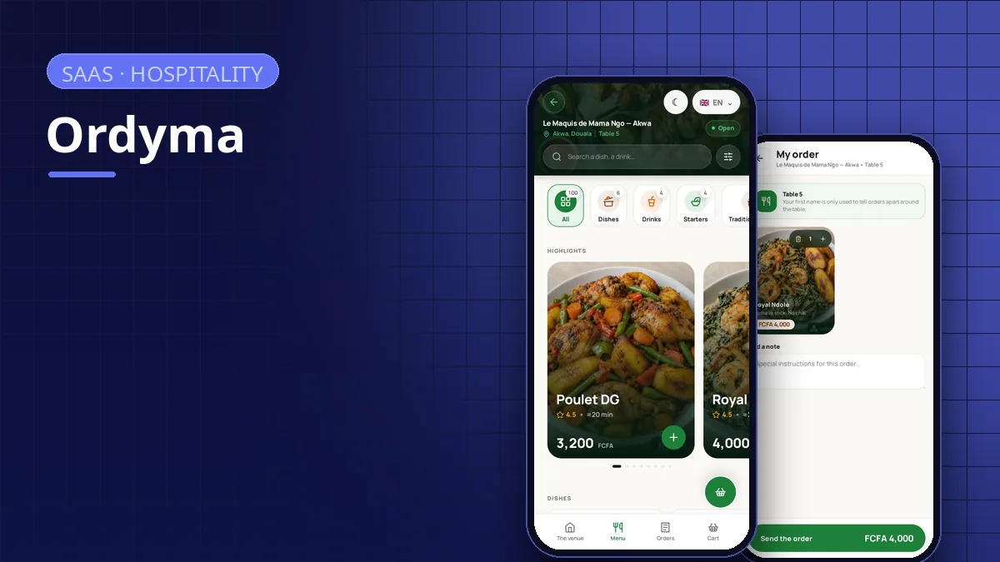
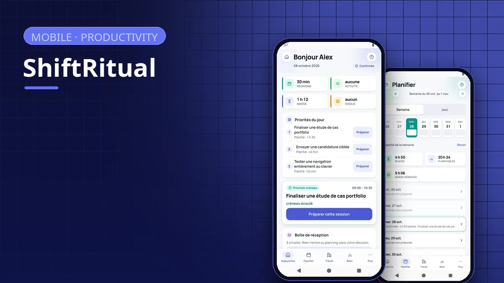

<!-- Onglets de langue : English | Français (actif) -->

  

<a href="https://th1nkdev.com">
  <picture>
    <source media="(prefers-color-scheme: dark)" srcset="./assets/banner-fr-dark.svg">
    
  </picture>
</a>

<h3 align="center">Nous construisons des produits numériques pour une Afrique prête à diriger.</h3>

  Studio logiciel basé à Douala, au Cameroun. Nous concevons, développons et lançons des produits web, mobiles et SaaS — 
  et nous formons les ingénieurs qui les font vivre.

  
  
  

 

<picture>
  <source media="(prefers-color-scheme: dark)" srcset="./assets/stats-fr-dark.svg">
  
</picture>

## ✦ Ce que nous faisons

<table>
  <tr>
    <td width="50%" valign="top">
      <h4>🧩 Développement web et mobile</h4>
      Applications web et mobiles sur mesure, conçues pour monter en charge, du MVP à la plateforme d'entreprise.
    </td>
    <td width="50%" valign="top">
      <h4>🚀 SaaS et ingénierie produit</h4>
      Plateformes multi-locataires pensées pour la croissance, de l'idée à la production.
    </td>
  </tr>
  <tr>
    <td valign="top">
      <h4>🎨 UI/UX et design produit</h4>
      Recherche utilisateur, parcours et interfaces accessibles, précises au pixel.
    </td>
    <td valign="top">
      <h4>🤖 Intégration d'IA et automatisation</h4>
      L'IA là où elle rapporte, les tâches répétitives automatisées, vos outils connectés.
    </td>
  </tr>
  <tr>
    <td valign="top">
      <h4>🔐 Cybersécurité</h4>
      Sécurité dès la conception, audits et pistes d'audit intégrées au produit.
    </td>
    <td valign="top">
      <h4>☁️ Cloud et DevOps</h4>
      Infrastructure conteneurisée, pipelines CI/CD et exploitation fiable.
    </td>
  </tr>
  <tr>
    <td valign="top">
      <h4>🔎 Audit technique et conseil</h4>
      Revues de code et d'architecture, avec des recommandations concrètes.
    </td>
    <td valign="top">
      <h4>🎓 Académie et formation</h4>
      Des programmes pratiques qui rendent les équipes autonomes.
    </td>
  </tr>
</table>

<a href="https://th1nkdev.com/services">Tous les services →</a>

## ✦ Réalisations phares

<table>
  <tr>
    <td width="50%" valign="top">
      
      <b><a href="https://th1nkdev.com/projects/smartkyc">SmartKYC</a></b> 
      Une identité vérifiée réutilisable pour la zone CEMAC : le client possède son dossier, les institutions obtiennent un accès explicite, limité et révocable.
    </td>
    <td width="50%" valign="top">
      
      <b><a href="https://th1nkdev.com/projects/oac">OAC</a></b> 
      Ouverture de compte à distance pour une banque de la zone CEMAC : identité, biométrie, filtrage, décision et convention signée, avec une piste d'audit chaînée.
    </td>
  </tr>
  <tr>
    <td valign="top">
      
      <b><a href="https://th1nkdev.com/projects/ajustone">Ajustone</a></b> 
      Un rapprochement bancaire assisté par IA qui escalade vers un humain plutôt que de deviner. Règles déterministes d'abord, chaque décision tracée.
    </td>
    <td valign="top">
      
      <b><a href="https://th1nkdev.com/projects/groupe-isis">Groupe ISIS</a></b> 
      Supervision d'appliances de sauvegarde anti-rançongiciel déconnectées par conception : synchronisation différée, réconciliation, alertes de cycle manqué.
    </td>
  </tr>
  <tr>
    <td valign="top">
      
      <b><a href="https://th1nkdev.com/projects/muuvz">MuuVZ</a></b> 
      Une plateforme de covoiturage en production au Canada : sa première app mobile, la messagerie temps réel et la reprise complète du produit pendant le rebrand.
    </td>
    <td valign="top">
      
      <b><a href="https://th1nkdev.com/projects/cv-action">CV Action</a></b> 
      Des documents de carrière pour le marché africain, avec des PDF identiques à l'aperçu, des paiements africains et six langues.
    </td>
  </tr>
  <tr>
    <td valign="top">
      
      <b><a href="https://th1nkdev.com/projects/ordyma">Ordyma</a></b> 
      Plateforme de gestion pour restaurants, bars, caves et hôtels : commande par QR, plan de salle, commandes en temps réel. En pilote.
    </td>
    <td valign="top">
      
      <b><a href="https://th1nkdev.com/projects/shiftritual">ShiftRitual</a></b> 
      App mobile de planning et de gestion d'équipe, avec son site vitrine.
    </td>
  </tr>
</table>

<a href="https://th1nkdev.com/projects">Toutes les études de cas →</a>

## ✦ Notre stack

Nous choisissons la stack pour le problème, pas l'inverse.

<table>
  <tr>
    <td><b>Front-end</b></td>
    <td>
      
      
      
      
    </td>
  </tr>
  <tr>
    <td><b>Mobile</b></td>
    <td>
      
      
      
    </td>
  </tr>
  <tr>
    <td><b>Back-end</b></td>
    <td>
      
      
      
      
    </td>
  </tr>
  <tr>
    <td><b>Données</b></td>
    <td>
      
      
      
      
    </td>
  </tr>
  <tr>
    <td><b>IA et documents</b></td>
    <td>
      
      
      
    </td>
  </tr>
  <tr>
    <td><b>Infrastructure</b></td>
    <td>
      
      
      
    </td>
  </tr>
</table>

## ✦ Notre méthode

<table>
  <tr>
    <td align="center" width="25%"><h3>01</h3><b>Découvrir</b> Contexte, objectifs et contraintes.</td>
    <td align="center" width="25%"><h3>02</h3><b>Concevoir</b> Architecture, parcours et prototypes — avant le code.</td>
    <td align="center" width="25%"><h3>03</h3><b>Construire</b> Code propre, testé, documenté.</td>
    <td align="center" width="25%"><h3>04</h3><b>Lancer</b> Mise en production sans surprise, et nous restons.</td>
  </tr>
</table>

> **Nous pensons comme des fondateurs, pas comme des prestataires.** Code typé, tests automatisés et CI/CD sont notre base, et chaque mission se termine par de la documentation et un transfert de compétences.

## ✦ Construisons ensemble

  Un produit à lancer, une plateforme à reprendre, une équipe à former ?  
  
  

  
  
  
  
  

La plupart de nos dépôts sont des travaux clients ou produits privés. Une faille de sécurité ? Suivez notre <a href="https://github.com/th1nkdev-io/.github/blob/main/SECURITY.md">politique de sécurité</a>.

