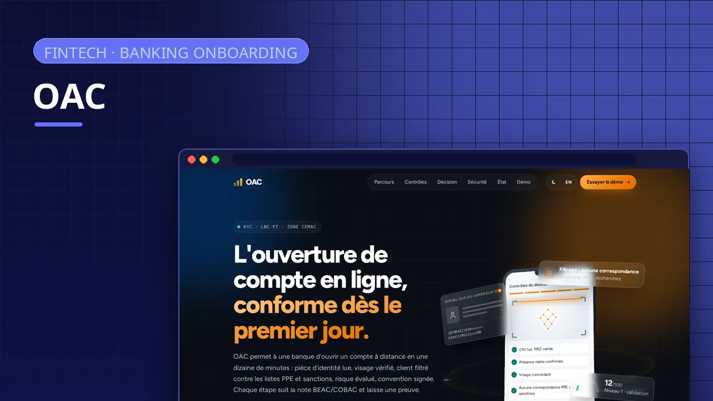
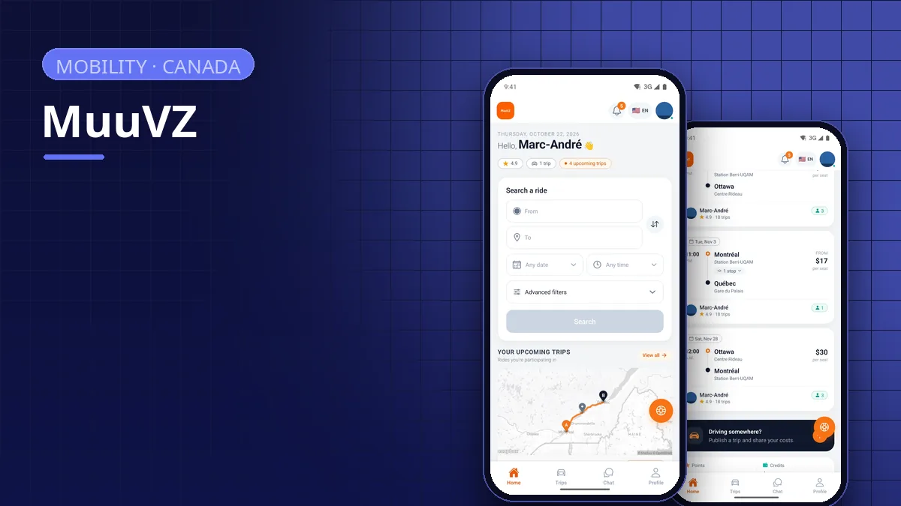
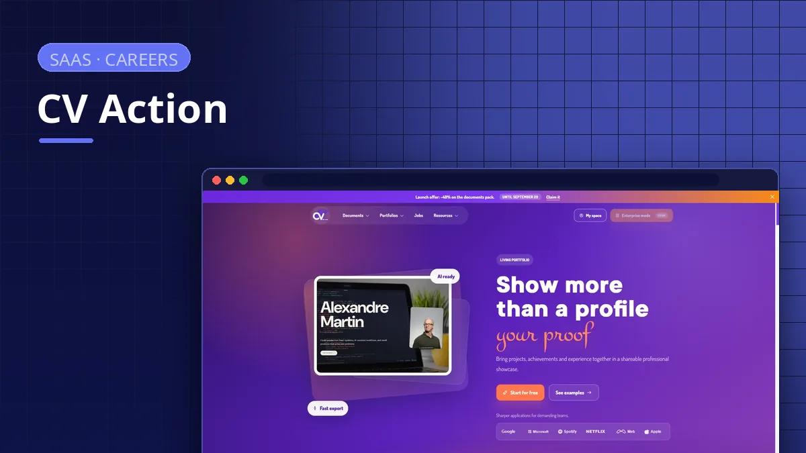
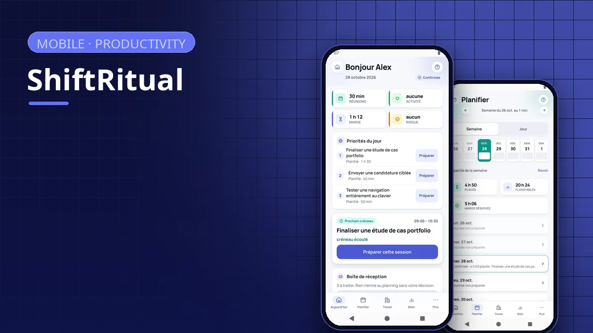

<!-- Language tabs: English (active) | Français -->

  

<a href="https://th1nkdev.com">
  <picture>
    <source media="(prefers-color-scheme: dark)" srcset="./assets/banner-dark.svg">
    
  </picture>
</a>

<h3 align="center">We build digital products for an Africa ready to lead.</h3>

  Software studio based in Douala, Cameroon. We design, build and launch web, mobile and SaaS products — 
  and we train the engineers who keep them running.

  
  
  

 

<picture>
  <source media="(prefers-color-scheme: dark)" srcset="./assets/stats-dark.svg">
  
</picture>

## ✦ What we do

<table>
  <tr>
    <td width="50%" valign="top">
      <h4>🧩 Web & mobile development</h4>
      Custom web and mobile apps built to scale, from MVP to enterprise platform.
    </td>
    <td width="50%" valign="top">
      <h4>🚀 SaaS & product engineering</h4>
      Multi-tenant platforms engineered for growth, from idea to production.
    </td>
  </tr>
  <tr>
    <td valign="top">
      <h4>🎨 UI/UX & product design</h4>
      Research, user flows and accessible, pixel-accurate interfaces.
    </td>
    <td valign="top">
      <h4>🤖 AI integration & automation</h4>
      AI where it pays off, repetitive workflows automated, tools connected.
    </td>
  </tr>
  <tr>
    <td valign="top">
      <h4>🔐 Cybersecurity</h4>
      Security-first design, audits and audit trails built into the product.
    </td>
    <td valign="top">
      <h4>☁️ Cloud & DevOps</h4>
      Containerised infrastructure, CI/CD pipelines and reliable operations.
    </td>
  </tr>
  <tr>
    <td valign="top">
      <h4>🔎 Technical audit & consulting</h4>
      Code and architecture reviews with actionable recommendations.
    </td>
    <td valign="top">
      <h4>🎓 Academy & training</h4>
      Hands-on programmes that leave teams autonomous.
    </td>
  </tr>
</table>

<a href="https://th1nkdev.com/services">All services →</a>

## ✦ Selected work

<table>
  <tr>
    <td width="50%" valign="top">
      
      <b><a href="https://th1nkdev.com/projects/smartkyc">SmartKYC</a></b> 
      Reusable verified identity for the CEMAC zone: the customer owns the file, institutions get explicit, limited and revocable access.
    </td>
    <td width="50%" valign="top">
      
      <b><a href="https://th1nkdev.com/projects/oac">OAC</a></b> 
      Remote account opening for a CEMAC bank: identity, biometrics, screening, risk decision and signed agreement, with a hash-chained audit trail.
    </td>
  </tr>
  <tr>
    <td valign="top">
      
      <b><a href="https://th1nkdev.com/projects/ajustone">Ajustone</a></b> 
      AI-assisted bank reconciliation that escalates to a human instead of guessing. Deterministic rules first, every decision audited.
    </td>
    <td valign="top">
      
      <b><a href="https://th1nkdev.com/projects/groupe-isis">Groupe ISIS</a></b> 
      Supervision of anti-ransomware backup appliances that are offline by design: deferred sync, reconciliation, missed-cycle alerts.
    </td>
  </tr>
  <tr>
    <td valign="top">
      
      <b><a href="https://th1nkdev.com/projects/muuvz">MuuVZ</a></b> 
      A carpooling platform in production in Canada: its first mobile app, real-time messaging and a full product takeover during the rebrand.
    </td>
    <td valign="top">
      
      <b><a href="https://th1nkdev.com/projects/cv-action">CV Action</a></b> 
      Career documents for the African market, with PDFs that match the preview exactly, African payment rails and six languages.
    </td>
  </tr>
  <tr>
    <td valign="top">
      
      <b><a href="https://th1nkdev.com/projects/ordyma">Ordyma</a></b> 
      Management platform for restaurants, bars, cellars and hotels: QR ordering, floor plan, real-time orders. In pilot.
    </td>
    <td valign="top">
      
      <b><a href="https://th1nkdev.com/projects/shiftritual">ShiftRitual</a></b> 
      A fully mobile scheduling and team management app, with its showcase website.
    </td>
  </tr>
</table>

<a href="https://th1nkdev.com/projects">All case studies →</a>

## ✦ Our stack

We pick the stack for the problem, not the other way around.

<table>
  <tr>
    <td><b>Front end</b></td>
    <td>
      
      
      
      
    </td>
  </tr>
  <tr>
    <td><b>Mobile</b></td>
    <td>
      
      
      
    </td>
  </tr>
  <tr>
    <td><b>Back end</b></td>
    <td>
      
      
      
      
    </td>
  </tr>
  <tr>
    <td><b>Data</b></td>
    <td>
      
      
      
      
    </td>
  </tr>
  <tr>
    <td><b>AI & documents</b></td>
    <td>
      
      
      
    </td>
  </tr>
  <tr>
    <td><b>Infrastructure</b></td>
    <td>
      
      
      
    </td>
  </tr>
</table>

## ✦ How we work

<table>
  <tr>
    <td align="center" width="25%"><h3>01</h3><b>Discover</b> Context, goals and constraints.</td>
    <td align="center" width="25%"><h3>02</h3><b>Design</b> Architecture, flows and prototypes — before code.</td>
    <td align="center" width="25%"><h3>03</h3><b>Build</b> Clean, tested, documented code.</td>
    <td align="center" width="25%"><h3>04</h3><b>Launch</b> Zero-surprise go-live, then we stay.</td>
  </tr>
</table>

> **We think like founders, not contractors.** Typed codebases, automated tests and CI/CD are our baseline, and every engagement ends with documentation and knowledge transfer.

## ✦ Let's build something

  Have a product to launch, a platform to rescue or a team to train?  
  
  

  
  
  
  
  

Most of our repositories are private client or product work. Found a security issue? Please follow our <a href="https://github.com/th1nkdev-io/.github/blob/main/SECURITY.md">security policy</a>.

