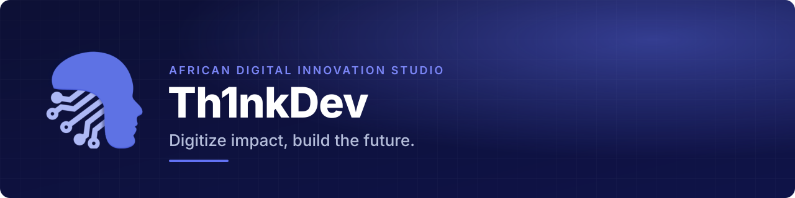

  

  <a href="https://th1nkdev.com"><b>Website</b></a> ·
  <a href="https://th1nkdev.com/projects">Case studies</a> ·
  <a href="https://th1nkdev.com/services">Services</a> ·
  <a href="https://th1nkdev.com/academy">Academy</a> ·
  <a href="https://th1nkdev.com/careers">Careers</a> ·
  <a href="mailto:contact@th1nkdev.com">contact@th1nkdev.com</a>

<a href="#-version-française">🇫🇷 Version française plus bas</a>

---

## We build digital products for an Africa ready to lead

**Th1nkDev** (pronounced *Think Dev*) is a software studio based in Douala, Cameroon. We design, build and launch web, mobile and SaaS products — and we train the engineers who keep them running.

We think like founders, not contractors: every product is built to last, not just to launch. Clean architecture, typed codebases, automated tests and CI/CD are our baseline, not an option.

| Since **2015** | **60+** projects delivered | **120+** talents trained | **5** countries · **3** continents |
| :---: | :---: | :---: | :---: |

## What we do

| | |
| --- | --- |
| 🧩 **Web & mobile development** | Custom web and mobile apps built to scale, from MVP to enterprise platform. |
| 🚀 **SaaS & product engineering** | Multi-tenant platforms engineered for growth, from idea to production. |
| 🎨 **UI/UX & product design** | Research, flows and accessible, pixel-accurate interfaces. |
| 🤖 **AI integration & automation** | AI where it pays off, workflows automated, tools connected. |
| 🔐 **Cybersecurity** | Security-first design, audits and audit trails built into the product. |
| ☁️ **Cloud & DevOps** | Containerised infrastructure, CI/CD pipelines and reliable operations. |
| 🔎 **Technical audit & consulting** | Code and architecture reviews with actionable recommendations. |
| 🎓 **Academy & training** | Hands-on programmes that leave teams autonomous. |

→ [Explore our services](https://th1nkdev.com/services)

## Selected work

| Product | What it does |
| --- | --- |
| **[SmartKYC](https://th1nkdev.com/projects/smartkyc)** · fintech, security | Reusable verified identity for the CEMAC zone: the customer owns the file, institutions get explicit, limited and revocable access. Multi-tenant, full audit trail, signed partner API. |
| **[OAC](https://th1nkdev.com/projects/oac)** · fintech, security | Remote account opening for a CEMAC bank: identity, biometrics, screening, a risk decision and a signed agreement, with a hash-chained audit trail. |
| **[Ajustone](https://th1nkdev.com/projects/ajustone)** · fintech, AI | AI-assisted bank reconciliation that escalates to a human instead of guessing: deterministic rules first, AI for fuzzy matching, every decision audited. |
| **[Groupe ISIS](https://th1nkdev.com/projects/groupe-isis)** · security, SaaS | Supervision of a fleet of anti-ransomware backup appliances that are offline by design: deferred sync, reconciliation on reconnection, missed-cycle alerts. |
| **[MuuVZ](https://th1nkdev.com/projects/muuvz)** · mobility | A carpooling platform in production in Canada: its first mobile app, real-time messaging, and a full product takeover during the rebrand. |
| **[CV Action](https://th1nkdev.com/projects/cv-action)** · SaaS | Career documents for the African market, with PDFs that match the preview exactly, payments on African rails and six languages including Arabic. |
| **[Ordyma](https://th1nkdev.com/projects/ordyma)** · SaaS | Management platform for restaurants, bars, cellars and hotels: QR ordering, floor plan, real-time orders, staff and recipes. In pilot. |
| **[ShiftRitual](https://th1nkdev.com/projects/shiftritual)** · SaaS, mobile | A fully mobile scheduling and team management app, with its showcase website. |

→ [See all case studies](https://th1nkdev.com/projects)

## Our stack

We pick the stack for the problem, not the other way around. What we ship with most:

**Front end** — Vue 3 · Nuxt · TypeScript · Tailwind CSS
**Mobile** — React Native · Expo · Capacitor
**Back end** — Node.js · AdonisJS · Laravel · Python · WebSocket
**Data** — PostgreSQL · MySQL · Redis · Drizzle
**AI & documents** — ONNX Runtime · Tesseract · Playwright
**Infrastructure** — Docker · Nginx · CI/CD on GitHub Actions

## How we work

**Discover** the context and constraints → **Design** the architecture and flows before code → **Build** clean, tested, documented software → **Launch** without surprises, then stay for maintenance and growth.

Every engagement ends with documentation and knowledge transfer: we leave teams stronger than we found them.

## Let's build something

Have a product to launch, a platform to rescue or a team to train?

  <a href="https://th1nkdev.com/start-a-project"><b>→ Start a project</b></a> &nbsp;·&nbsp;
  <a href="https://th1nkdev.com/book">Book a call</a> &nbsp;·&nbsp;
  <a href="mailto:contact@th1nkdev.com">contact@th1nkdev.com</a>

  <a href="https://www.linkedin.com/company/th1nkdev">LinkedIn</a> ·
  <a href="https://x.com/th1nkdev0">X</a> ·
  <a href="https://www.instagram.com/th1nkdev/">Instagram</a> ·
  <a href="https://web.facebook.com/th1nkdev">Facebook</a>

Most of our repositories are private client or product work. Found a security issue? See our <a href="https://github.com/th1nkdev-io/.github/blob/main/SECURITY.md">security policy</a>.

---

<h2>🇫🇷 Version française</h2>

### Nous créons des produits numériques pour une Afrique prête à mener

**Th1nkDev** (prononcé *Think Dev*) est un studio logiciel basé à Douala, au Cameroun. Nous concevons, développons et lançons des produits web, mobiles et SaaS, et nous formons les ingénieurs qui les font vivre.

Nous pensons comme des fondateurs, pas comme des prestataires : chaque produit est construit pour durer, pas seulement pour être livré. Architecture propre, code typé, tests automatisés et CI/CD sont notre base, pas une option.

| Depuis **2015** | **60+** projets livrés | **120+** talents formés | **5** pays · **3** continents |
| :---: | :---: | :---: | :---: |

### Ce que nous faisons

- 🧩 **Développement web et mobile** — applications sur mesure, du MVP à la plateforme d'entreprise.
- 🚀 **SaaS et ingénierie produit** — plateformes multi-locataires pensées pour la croissance.
- 🎨 **UI/UX et design produit** — recherche, parcours et interfaces accessibles.
- 🤖 **Intégration d'IA et automatisation** — l'IA là où elle rapporte, des processus automatisés.
- 🔐 **Cybersécurité** — sécurité dès la conception, audits et pistes d'audit intégrées.
- ☁️ **Cloud et DevOps** — infrastructure conteneurisée, pipelines CI/CD, exploitation fiable.
- 🔎 **Audit technique et conseil** — revue de code et d'architecture, recommandations concrètes.
- 🎓 **Académie et formation** — des programmes pratiques qui rendent les équipes autonomes.

### Réalisations phares

- **[SmartKYC](https://th1nkdev.com/projects/smartkyc)** — une identité vérifiée réutilisable : le client possède son dossier, les institutions obtiennent un accès explicite, limité et révocable.
- **[OAC](https://th1nkdev.com/projects/oac)** — ouverture de compte à distance pour une banque de la zone CEMAC : identité, biométrie, filtrage, décision et convention signée.
- **[Ajustone](https://th1nkdev.com/projects/ajustone)** — un rapprochement bancaire assisté par IA qui escalade vers un humain plutôt que de deviner.
- **[Groupe ISIS](https://th1nkdev.com/projects/groupe-isis)** — supervision d'un parc d'appliances de sauvegarde déconnectées par conception.
- **[MuuVZ](https://th1nkdev.com/projects/muuvz)** — une plateforme de covoiturage en production au Canada : première app mobile et reprise complète du produit pendant le rebrand.
- **[CV Action](https://th1nkdev.com/projects/cv-action)** — des documents de carrière pour le marché africain, avec des PDF identiques à l'aperçu.
- **[Ordyma](https://th1nkdev.com/projects/ordyma)** — plateforme de gestion pour restaurants, bars, caves et hôtels : commande par QR, plan de salle, commandes en temps réel. En pilote.
- **[ShiftRitual](https://th1nkdev.com/projects/shiftritual)** — app mobile de planning et de gestion d'équipe, avec son site vitrine.

### Construisons ensemble

Un produit à lancer, une plateforme à reprendre, une équipe à former ?
**[→ Démarrer un projet](https://th1nkdev.com/start-a-project)** · [Réserver un appel](https://th1nkdev.com/book) · [contact@th1nkdev.com](mailto:contact@th1nkdev.com)

